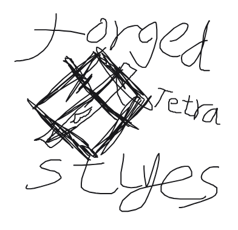

# 拔刀剑：百构流派

<p align="center">
  
</p>

<p align="center">
  <strong>Blade Tetra: Forged Styles</strong><br>
  面向 Minecraft 1.20.1 的 Tetra × 拔刀剑：重锋模块化锻刀与战斗流派扩展。
</p>

<p align="center">
  <a href="LICENSE"></a>
  
  
  
</p>

Blade Tetra 让玩家在 Tetra 工作台中锻造真正模块化的拔刀剑。刀身、柄、镡、鞘、鎺与柄头会共同决定武器的模型、材质、属性和战斗方式；同一把刀可以从开局一路改造到整合包毕业，而不是每隔几小时就被下一把成品刀替换。

> 当前源码版本为 **1.6.5**；此标记不表示已发布安装包。

## 核心内容

### 整合包战斗平衡配置

模块刀提供总伤害、四流派、SA、非 SA 幻影剑和离锋剑气共 8 个倍率，默认全部为 **1.0**。由存档/服务器的 `serverconfig/blade-tetra-server.toml` 控制，不影响其他模组的刀或御影伤害。配置菜单、修改生效与兼容边界见 [战斗平衡配置说明（中文 / English）](docs/COMBAT_BALANCE_CONFIG.md)。

- **模块化锻刀**：自由组合刀身、刀柄、刀镡、刀鞘等部件，并继承 Tetra 的材料、完整度、加工、修复与打磨体系。
- **四种预设流派**：本传、居合、连舞与断岳拥有不同的攻击节奏、范围、连段与风险收益。
- **千门剑谱**：采录最多六招普通动作，命名、排序、编辑并生成 Tetra 原生卷轴；在工作台加工为短、标准或长刀身。支持保留名称和动作顺序的离线短分享码。
- **秘传·离锋**：研习后在 SSS 下由真实普通斩击发出剑气，支持预设与自创流派；客户端提供三档剑气画质。
- **名刀映锻**：研习重锋本体及标准附属名刀，将其刀鞘与完整镡柄仿造成可混装的 Tetra 部件；同源刀装会形成动态映锻契合。
- **隐藏传承与魂铭**：通过锻刀秘录探索赤月、镜花水月、千本樱、雷切等觉醒，并允许部分魂铭融合。
- **御影内容保留**：普通挑战与回忆战暂时封印，等待战斗完善；保留旧进度与符合资格的非战斗访客入口。见[当前开放策略](docs/MIKAGE_CHALLENGE_SUSPENSION.md)。
- **动态材料美术**：读取已加载的 Tetra 材料，为刀身、刀装和刀光生成对应视觉，同时保留手工制作的特殊材料表现。
- **存档与附属兼容**：旧刀自动迁移；标准重锋附属名刀可以自动发现，特殊模型则可通过适配器扩展。

## 文档入口

- [全部文档与历史记录](docs/README.md)
- [千门剑谱操作、刀身与导入导出](docs/CUSTOM_STYLE_FINALIZATION.md#玩家操作)
- [离锋剑气与画质配置](docs/LIFENG_SWORD_AURA.md)
- [战斗与连招指南](docs/COMBAT_GUIDE.zh-CN.md)
- [特殊刀与隐藏传承 Wiki](docs/legacy-wiki/README.md)（答案默认折叠，避免意外剧透）
- [名刀映锻说明](NAMED_BLADE_IMPRINTING.md)
- [附属兼容说明](ADDON_COMPATIBILITY.md)
- [配置说明](CONFIGURATION.md)
- [镶嵌、裹柄与涂层](docs/SWORD_ATTACHMENTS.md)
- [解除死念](docs/DEAD_THOUGHT_REMOVAL.md)

## 环境与安装

- Minecraft `1.20.1`
- Forge `47.4.0`（支持范围 `[47,)`）
- Tetra `6.3.0` 至 `6.x`
- mutil `6.2.0` 至 `6.x`
- SlashBlade: Resharped / 拔刀剑：重锋 `1.9.63` 至 `1.x`
- Player Animator `1.0.2-rc1+1.20`（可选，推荐）
- More Mod Tetra / MMT `2.2.941` 至 `2.x`（可选，整合包材料推荐）

将本模组及必需依赖放入 Forge 实例的 `mods` 目录即可。赤月·大正酒狐是独立的非商业衍生模型包，不包含在本仓库或 Mod JAR 中，可前往 [Akatsuki Taisho Wine Fox](https://github.com/Bluelgin/Akatsuki-Taisho-Wine-Fox) 获取。

## 构建

使用 Java 17，在仓库根目录运行：

```text
gradlew build
```

构建产物位于 `build/libs`。依赖从公开 Maven 仓库下载，不会被打入本模组 JAR。

## 许可证与第三方资源

本项目代码与自有资源以 [MIT](LICENSE) 许可发布。内置御影模型、贴图为酒狐衍生美术，采用 CC BY-NC-SA 4.0（署名、非商业、相同方式共享），不属于 MIT 授权范围；分发时须保留对应署名与许可。第三方来源、改动与完整许可位置见 [THIRD_PARTY_NOTICES.md](THIRD_PARTY_NOTICES.md)。独立的赤月模型包同样采用 CC BY-NC-SA 4.0。

## 当前边界

- 自创剑谱只接受经过普通动作权限校验的招式；注册了动作 ID 不代表可直接导入或继承原流派的全部被动。
- 分享码保留剑谱名称和动作顺序；导入时仍由服务器验证所需模组、版本与普通招式权限，不兼容未发布的旧 `BTSTYLE1:` 格式。
- 部分美术状态仍缺可靠客户端接口，未伪造录制或锻造成功反馈，详见[客户端整合边界](docs/custom-style-art/CLIENT_INTEGRATION.md)。
- 原有版本日志仍在仓库根目录；Alpha 至 1.5.2 的旧首页内容移至[历史记录](docs/history/README_HISTORY.md)，不作为当前功能说明。
