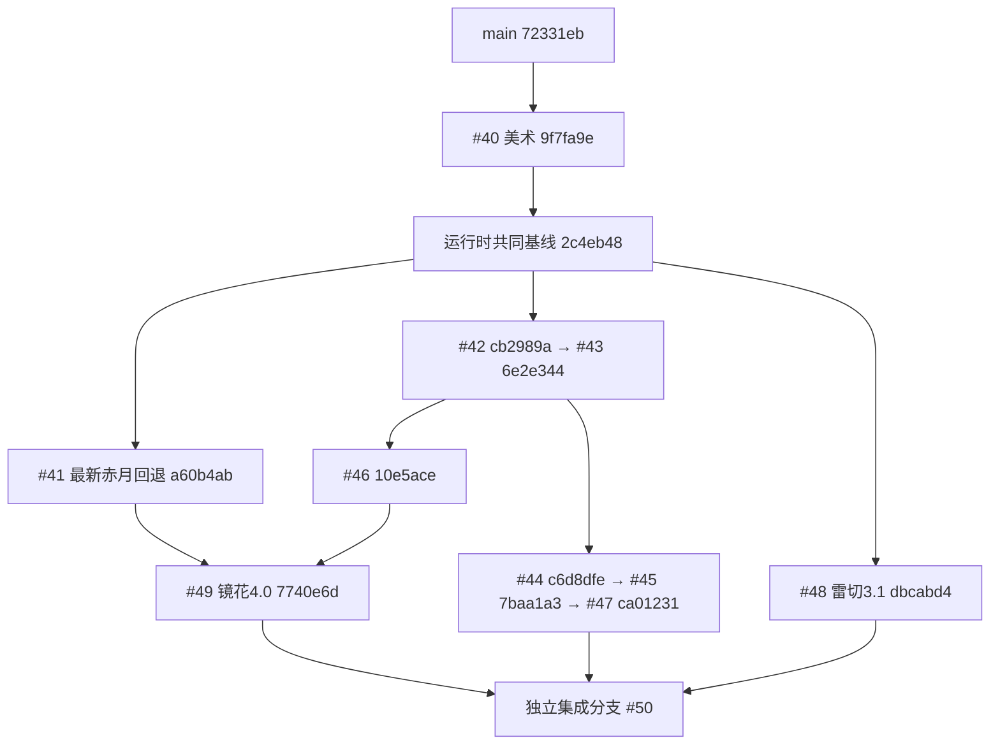

# 觉醒刀 2.0：当前集成架构

本文件是四刀联合版本的权威维护入口；其他轮次文档记录设计和历史实验，不能覆盖这里的实际行为。集成 PR #50，基线 main `72331ebbf5f0f62f2aded0cf28a713ca3a146fb7`。精确输入 HEAD、base、共同祖先、提交及文件清单见 [INTEGRATION_SOURCES.json](INTEGRATION_SOURCES.json)。

## 实际提交依赖与集成路径

这里 #41 最新 HEAD **不是** #42/#48 的祖先，不能把它们的旧赤月文件当成最新版。#49 已显式合入 #41 最新回退。集成分阶段使用 merge 保留真实提交祖先：从 main 合入 #40/#41，接着合入包含 #42/#43/#46 的 #49，最后合入 #47 和 #48。没有重复挑选每条历史提交。GitHub 写入使用 Git data API 创建等价树和多父提交；本地与远端各阶段文件树一致，未重写任何原 PR。

## 四刀实际行为与职责

| 刀魂 | 当前规则 | 主要维护入口 |
| --- | --- | --- |
| 赤月 | 原有低血量终月处决、原伤害源、固有剑灵桥接和旧终月协奏；保留新真名仪式 | `AkatsukiExecution`、`AkatsukiAwakening`、`ContractBladeCompat` |
| 千本樱3.0 | 原生下劈散华、上挑凝刃；普通B1–B7命中触发碎刃协奏，不额外扣Rank；原生SA启动独立B1–B6连舞并燃烧原生Rank；耗尽保持散华 | `SakuraStanceController`、`SakuraCombatVisuals`、`SakuraShardAttackService`、`SakuraInfiniteDanceSA`、`SakuraDanceCombos` |
| 雷切3.1 | 原生Shift+W+右键独占动作、位移、攻击；仅观察实际路径，14–22刻延迟残响；下坠斩驻留雷针周期放电/共振，雷针自身伤害不击退 | `RaikiriActionObserver`、`RaikiriFieldService`、`RaikiriRules`、`RaikiriConfig` |
| 镜花4.0 | 原生Spiral Swords激活水镜衣，用原版空气；有限卸力；原生攻击预约14刻/40%水斩；实际晋升SSS预约10刻后三镜追忆，总75%，600刻冷却 | `NativeBladeActionObserver`、`KyoukaMirrorSessions`、`KyoukaMirrorDamageService`、`WaterMirrorCombat`、`WaterMirrorDefenseBudget` |

`AwakenedBladeCombat` 只保留模式判定、四刀仪式入口、千本樱实际有效伤害转交和雷切共用合法目标/VFX助手。它不再拥有刀魂资源表、伤害队列、HUD心跳或位移。各刀魂独立维护有界状态和退出清理；共享 `InheritedCombatDamage`/`SoulLegacyDamageGuard` 避免附加伤害递归和原生Rank二次收益。没有新增Manager、总线、Mixin或自定义动画系统。

SlashBlade继续负责ComboState、原生输入、VMD、基础伤害、Rank和幻影剑。镜花沿用 #49 已验证的窄原生提交/伤害观察及最终玩家减伤观察；千本樱保留已有SA专用动作编排，不复制新的原生时间轴；雷切绝不主动推进、替换或传送原生迅捷斩。

## 仪式、渲染和存档

四刀均沿用 #43/#46/#49 的120刻仪式、原刀离手、真实模型/刀鞘留身及归刃。镜花采用破镜出刃；没有实时世界反射、离屏镜面或独立反射Shader。`AwakeningPresentationService` → `AwakeningPresentationPacket` → `AwakeningVisualController` 负责表现，与战斗是否采用旧版分开判断。

千本樱保留真实Tetra镡柄、原生鞘及统一碎刃池；镜花三镜保留原生VMD/Tetra无鞘刀渲染。雷切驻留剑使用有界队列和稳定视觉锚点，迟加入追踪仍由原有重发入口处理。

旧觉醒标记、铭刻材料ID、伤害源 `blade_tetra:akatsuki_execution`、原有物品/公开桥接保持不变。`awakened_sakura_b6` 是可能进入旧刀NBT的注册ID，保留其无害回收节点，不恢复旧自动续连。镜花旧 `[kyouka3]` 名称及弃用付款配置保留为显式忽略的迁移键；它们不能开启旧机制。旧 `KyoukaAwakening`/`SenbonzakuraAwakening` 中仍服务于关闭V2配置或觉醒/公开联动的方法保留，不按文件年龄删除。

## 网络

严格协议统一为 **`awakened2-integrated-1`**，两端均通过 `PROTOCOL::equals` 校验。客户端/服务器必须一起安装集成JAR。

| 消息ID | 用途 |
| --- | --- |
| 0–20 | 现有基础消息，含自创流派与原版联动 |
| 21 | 四刀VFX，方向限定服务端→客户端 |
| 22、23 | 旧HUD、旧镜影重演，已停用并保留空号 |
| 24 | 四刀真名仪式 |
| 25 | 镜花4镜影 |
| 10（原有） | 镜花水镜VFX；复用已有KyoukaVfxPacket |

VFX子类型0–4为基础表现，5–8仅为雷切驻留剑/移除/雷击/共振，9–12仅为带身份数据的千本樱挥击/命中/散华/凝刃。SakuraCue内部阶段仍为1–6和7/8，**不能用子类型新编号作为动作阶段**。合法性、双向编解码与跨刀魂误分发有专项回归。

各分支原本让雷切与千本樱共用5–8，Git自动合并不会报错；本次显式拆分。消息注册ID不重复。删除了没有生产者的旧HUD和镜像SA包/客户端处理器，避免无效协议入口。

## 双魂真实边界

| 组合 | 集成状态 |
| --- | --- |
| 赤月+镜花 | 保留原终月镜花表现调用；不使用镜花4历史快照；不能据此声称迁移了旧镜花主魂协奏 |
| 赤月+千本樱 | 保留旧终月消费已有花印入口；新版千本樱停止旧花印积累，不能承诺持续产生新协奏资源 |
| 赤月+雷切 | 保留旧终月 `resonanceDischarge`；需真人/第三方环境联合验收 |
| 镜花+千本樱 | 保留铭刻、觉醒和主魂；旧历史锚点协奏不调度，安全停用，待后续迁移 |
| 镜花+雷切 | 同上，不恢复旧镜像SA或附带传送 |
| 千本樱+雷切 | 保留铭刻、觉醒和主魂；旧编队/终击协奏不调度，待后续迁移 |

本次不设计六套新技能。非赤月主魂Tooltip明确显示以主魂运行，不能把 `SoulResonance.isFormed`（铭刻/流派资格）误当成新版协奏已完整实现。旧铭刻不会被删除或转化。

## 实际冲突与处理

| 冲突位置 | 解决方式 |
| --- | --- |
| 旧 #43 与 #41回退的HUD/VFX/战斗入口 | 先验证冲突后撤销临时合并，改用已整合两线的 #49；保留仪式，拒绝因果裁断 |
| #47 `AwakenedBladeCombat` | 采用真实命中→SakuraCombatVisuals；保留 #49镜花观察，排除旧赤月、镜花SA和千本樱Shift+SA切换 |
| #48共享战斗类/Math/RankCost | 雷切由独立观察器接管；清除无引用传送、雷荷/终击、旧数学谓词及旧付款代码；无双套伤害调度 |
| VFX客户端/包 | 复用 #47共享图集助手与碎刃池，接入 #48有界队列和驻留剑；拆分子类型编号，不恢复赤月因果战斗图层 |
| BladeTetra注册 | 同时保留水镜效果、千本樱动作和原有四刀；移除旧Rapid注册调用 |
| 配置/网络 | 合并三刀仍使用的配置；过时迁移键标注忽略；统一严格协议，旧消息ID留空 |
| Gradle/CI | 保留三刀现有专项入口；统一一次build/JUnit/API审计，再执行联合Forge组和原有基线CI |
| 中英文/历史说明 | 更新当前玩法Tooltip与配置协议；历史轮次说明顶部指向本文，不批量重写历史实验 |

## 验证与人工验收

自动化证据以集成PR最新提交的Actions为准，不继承原PR的“通过”结论。联合回归复用镜花原生专服、千本樱普通/SA/碎刃/生命周期专服、雷切原生专服；在现有千本樱专服中加一次四刀保存往返、四刀真实原生命中、旧终月伤害入口、四刀仪式包与六种双魂铭刻共存检查。没有新测试框架。赤月完整终月斩杀及Contract-Blade实际安装环境仍需作者验收，代码保持与 #41回退版一致。

JUnit、FakePlayer专服、独立图形客户端资源检查分别记录，均不称为真人实机通过。作者应使用Actions `blade-tetra-review-build` 的生产JAR检查：

- 四刀在同一世界内轮换，原生输入/动画/伤害/Rank和重登存档正常。
- 赤月低血量终月完整流程，固有剑灵联动及三种旧终月协奏的实际边界。
- 千本樱下劈/上挑、普通B1–B7、独立SA B1–B6、耗尽后散华；真实镡柄/鞘/碎刃归阵。
- 雷切真实路径14–22刻延迟落雷、下坠驻留雷针周期/共振、无额外传送/扣Rank/雷针击退。
- 镜花原生环剑→水镜衣、空气/呼吸饰品、有限卸力、水斩与SSS追忆。
- 四刀仪式第一/第三人称离手、鞘留身、镜花破镜及归刃。
- 多人旁观/迟加入、延迟、退出/换维度/换刀、保护模组、资源重载、低中高画质与实际FPS。

旧PR和分支全部保留。仅在 #50完成人工验收并正式合并后，重新获取各PR最新HEAD并以 `merge-base --is-ancestor` 核对包含关系；有新增未包含提交的PR必须单独审查，不批量关闭。
