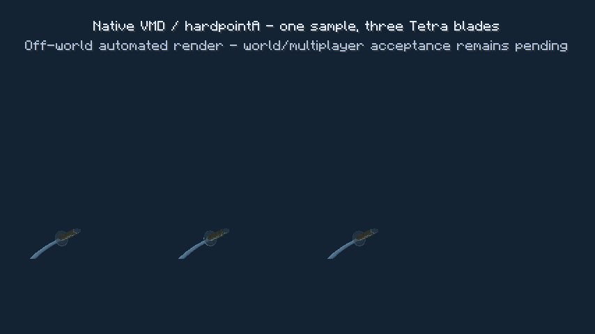

# 镜花水月 3.0 · 三镜映刃（Draft）

## 基线与源码调查

主基线 #46 `10e5aced2e74da408537390faa98b61334505bd1`，继承 #43 `6e2e3444538ebf34fb5c9d4d67a1b9a3215bfb06`。
补入 #41 `a60b4ab834f56ff4883336746e53f15ce0057570` 的赤月 V2 回退，冲突保留 #46 已有 SakuraEndlessFlow，不恢复赤月因果队列。#47 `ca0123131f6173fbd95bebbc7862a08f805d5c81`、#48 `344adeb4026f6bdb54d4491f834420c183e047a1` 未合入。#46 自身依赖旧千本樱2.x栈，该既有依赖未删除。

实际 Gradle 依赖为 CurseForge file 8018222（SlashBlade 1.9.63），Tetra file 5236744、Forge 47.4.0、Java17。已调查上游 1.9.63 源码提交 `0c1034e886ca1e76421ead8d82704bde739edd2e`。本地初始没有依赖 JAR/Gradle 缓存。随后在 CI 用 `kyoukaNativeApiAudit` 对实际解析的 8018222 JAR 运行 javap，核对 updateComboSeq 的取消/提交顺序、areaAttack 两种最终重载、EntitySlashEffect 非cycle/cycle窗口、Rank的两个入口及 LayerMainBlade 的真实采样时钟；审计文本随 CI artifact 提供。

`NextComboEvent` 是候选/虚拟路由；`BladeMotionEvent` 可取消/改写；`PerformSlashArtEvent` 不是提交事实。对 `ISlashBladeState.updateComboSeq` 中最终 `setLastActionTime` 完成处只读注入，位于原生 clickAction 之前。Mixin 0.8.5 不支持接口默认方法 @Inject，故使用一个空标记 Mixin + 既有插件的窄 ASM post-apply bridge，校验该方法中唯一的时间戳写入后插入一次观察调用，不移除或重排原生指令；找不到或出现歧义时拒绝加载，避免默默失去权威观察。没有调用、复制或注册 ComboState，没有替换输入、移动、tickAction/clickAction/hitEffect。

## 状态、动作与渲染

仅真实加入世界、未发射、所有者正确的原生 EntitySpiralSwords 批次触发。生成事件按 owner + tick 分组，tick末核实实体仍登记在世界且乘骑 owner，避免后续事件取消造成假激活。同一玩家一组会话，固定激活时的原生锁定敌人。原生6/8环剑和三把无鞘镜刃同时存在，原生耀魂、发射、动画、伤害、寿命均不改。

原生环剑最后一把失效/发射、换刀/刀UUID改变、死亡、离线、维度/目标失效、范围或B级门槛失败即清理。没有另设10秒服务器计时器，不加载区块、不扫描怪物。默认32格、每世界32组、全服64组可配置。

NativeBladeMotionSampler 独立读取 BladeMotionManager/VMD、bladeholder.pmd、hardpointA 的 skinning matrix；复用 LayerMainBlade 的坐标转换，一次世界渲染只采样一次，三把刀共享同一矩阵，以120°阵位面对目标。1.9.63 LayerMainBlade 实际未把 getSpeed 乘到 VMD 时钟，故镜刃匹配其 wall-clock 采样；getSpeed 仍通过 getTimeoutMS 限制动作有效期。无有效VMD、骨骼、第三方专用渲染时降级为待机，不伪造动作，不执行第三方超时路由来推算后续节点。

外观复用 FloatingBladeRenderer.prepare/Prepared、原生OBJ和RenderOverrideEvent/Tetra材质适配；增加独立半透明银蓝刀身pass，排除鞘；未改觉醒时间轴、未引入反射shader或世界二次渲染。MMD/外观资源在重载后重建，动作无需 RenderPlayerEvent 或玩家在观察距离内。

服务器S2C协议 `kyouka3-native-1` / ID25。目标96格内观察者按进出范围收到快照/停止，动作只发combo ID、服务器时间/序号、身份和yaw；外观仅首次快照发送。80tick轻量状态心跳兜底，客户端240tick无更新清理仅是视觉断线防漏。目标UUID保护实体ID复用。

## 75%预算和边界

观察真实 AttackManager.areaAttack 返回，而非已有 LivingDamage。已登记原生 EntitySlashEffect 以原生 alreadyHits 列表身份关联其已提交动作：非cycle剑气每实体一次，cycle剑气每真实tick窗口一次。原生多段的不同实体/时间各有预算；直接areaAttack只接受当前已提交、未超时且非待机的动作；同一tick同ratio直接窗口保守去重，无法区分的第三方同tick同ratio多段可能少结算而不会膨胀。同一窗口重复调用去重，每动作最多64窗口、保留32动作、每会话最多64剑气、全服待结算4096。

近战使用原生 AttackHelper.calculateTotalDamage(owner,target,ratio,isCriticalHit)，包含原生剑技ratio、附魔、Rank/refine、暴击和服务端SlashBlade伤害设置；间接原生剑气用审计后的原生公式 `(getDamage*ATTACK_DAMAGE+rankBonus)*ratio*SlashBladeScale*global`。每窗口形成**一份** `nativeBaseline*0.75`，20→15，不按三把刀再乘三。拒绝NaN、非正及超过1024的异常基准。通过既有 CombatBalanceRuntime.authoredDamage/InheritedCombatDamage、SoulLegacyDamageGuard 和既有 kyouka_mirror 二次伤害源结算，复用锻造SA的源阶段倍率快照，不重复触发居合进攻回调或二次套用SA阶段倍率。保留项目倍率和Forge伤害保护，限制PVP/友方/驯服动物，追加伤害不再生成技能或Rank。最终平衡预算超过768或非有限值时跳过。攻击保护直接发布可取消的 AttackEntityEvent；不调用 ForgeHooks.onPlayerAttackTarget，因为它会执行 ItemSlashBlade.onLeftClickEntity 并合成一次原生输入。只在合法窗口临时绕过hurt cooldown，finally恢复原值和目标速度。

支持使用审计过areaAttack入口的原生A/B、居合、上挑、下坠与项目自定义流派。特殊SA（例如JudgementCut自己hurt的攻击）、自定义剑气子类、未知排除列表、绕过areaAttack的第三方攻击只同步可用VMD，不追加伤害。不能宣称所有第三方SA都支持。native calculateTotalDamage 会发CriticalHitEvent，仅计算阶段事件，不重放攻击/移动/击中回调；第三方在该事件中的非纯副作用需实机兼容测试。

## Rank

A及以上激活，原生unit capacity与grade双重核对，启动费支付后也必须至少能维持B级；无法维持的配置/小unit实现不先扣启动费。默认启动60、每秒12、每合法攻击动作一次18；低于B停止。3.0始终有真实Rank代价，不使用旧V2的可关闭Rank收费开关或旧replay价格，不额外收双魂附加费。

只对会话登记的原生ConcentrationRank capability启用增益封锁：Mixin覆盖其原生addRankPoint(user,long)，正数在写入/同步前拒绝，负数继续原生处理；DamageSource增益重载在解析连招前直接返回，避免二次伤害的Rank回调推进原生Combo；setRawRankPoint直接正向写入也拒绝。自然衰减不写回，不每tick覆盖余额。不注册Sakura锁，不改变其现有tick ceiling，武器切换后解除镜花锁。替代capability实现未审计，故拒绝激活，避免宣称未知实现零瞬时增益。第三方直接改字段/绕过setter不在兼容保证内。

魂铭、双魂组合与觉醒存档/仪式保持；旧的镜花V2历史记录SA及其依赖的历史锚点追加不再是3.0的触发来源。赤月为主魂的旧终月协奏仍走#41保留的旧接口。

## 验证

本地网络无法下载Gradle发行包，且仅有Java运行时；本地未完成Gradle编译。CI已实际完成构建/JUnit，并运行独立的图形客户端VMD/OBJ smoke（53项）及原生专服24项基础检查（后续提交扩展八owner、其他幻影剑技、快照、本体伤害和无敌帧检查，最终数量与结论以确切HEAD日志为准）。自动化可以执行如下：

```sh
./gradlew build kyoukaNativeApiAudit
mkdir -p build/kyouka-native-smoke
printf 'eula=true\n' > build/kyouka-native-smoke/eula.txt
./gradlew runServer -PkyoukaNativeSmoke
xvfb-run -a ./gradlew runClient -PkyoukaMotionSmoke
```

客户端 smoke 真实加载原生PMD/VMD与Tetra外观，在无世界、无玩家实体的测试屏幕上，从同一矩阵绘制三把刀；覆盖A1–A3、B1–B7与未知动作降级、采样器重建。下面是它生成的实际帧，不是设计图或世界内实机验收：



没有完成世界内真人游玩、八人真实联网、第一/第三人称全流程、完整资源重载与FPS验收；专服八owner使用FakePlayer测试隔离，生产功能本身不创建FakePlayer。CI还运行既有Mikage、自定义流派、Lifeng和Sword Aura回归；仅以最新HEAD各步骤的实际结论为准。

实机验收流程（全部待执行）：
1. 已觉醒镜花/A级/锁定僵尸，原生Spiral产生6把，检查周身原生环剑+目标三镜同时存在，付60且只激活一次。普通中键、Storm、HeavyRain、耀魂不足、无锁定、非主魂/未觉醒/坏刀不得激活或额外付费。
2. B1–B7、A系、居合、上挑、下坠、内置自定义流派：玩家在近处/远至31格执行同一原生动作，三镜同步；比较普通刀原生回调次数、倍率、移动。自定义VMD缺失时待机；特殊SA观察降级。
3. 受控20伤害窗口，三镜合计15；本体命中时总35；多段按原生窗口分别统计。测试取消LivingAttack/玩家攻击保护、友方、PVP、墙后、无敌帧，追加不递归/不发Rank。
4. A门槛及不同unit capacity，启动/秒费/动作费，正向原生与直接setter增益拒绝、负向/自然衰减保留，跌B终止，换千本樱不污染其Rank约束。
5. 环剑提前发射、部分/全部删除、重复施法、换刀、刀损坏、死亡、离线、跨维度、目标死亡/卸载/移除/超距。确认不重锁其他目标、不加载区块。
6. 八名玩家分别不同目标/同目标，旁观者先进入/后加入/退出96格、玩家不在目标实体跟踪范围、延迟、目标ID复用。资源重载，第一/第三/旁观视角，特殊OBJ与Tetra材质刀装；低中高画质逐帧及FPS记录。镜花破镜出刃/原刀归刃完整回归。
