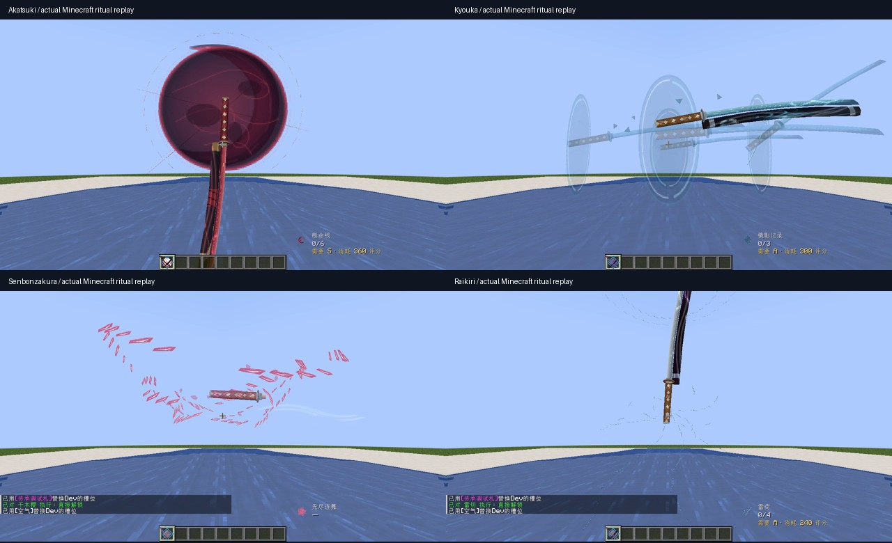

# 真名解放验收记录 · 2026-10-27

## 本轮反馈更新：刀鞘留在玩家身上

按用户反馈，四刀仪式现改为只有真实刀身离手，刀鞘沿用玩家原生挂载显示；千本樱分解/重凝不再影响刀鞘。移除浮空刀鞘及其透明度、矩阵会话状态，RendererAdapter的Prepared接口只绘制刀身。新增可见性回归断言，覆盖所有会话标志组合下sheath/sheath_luminous均不被抑制；散华预览在会话期间保留同一主手武器的原生刀鞘。

本轮构建/单测以PR最新CI为准；本地临时Gradle和客户端依赖缓存已被清理，尚未重录该调整。**下列截图、MP4及实机记录属于调整前的c3917e3版本，包含浮空刀鞘，不能当作本轮新行为的实机证据。**

## 前一轮完整实现与实机验证记录

验证的运行时代码：`c3917e3dd78f6c6a9387d9f91e4ee8e22ee49eaf`。后续文档/证据提交不改变此代码。

## 构建与自动验证

[GitHub Actions run 697](https://github.com/Bluelgin/Blade-Tetra-Forged-Styles/actions/runs/40366007842) 全绿：

- Java17 / Gradle 8.1.1 `build`、生产JAR重映射：通过。
- JUnit：472项，471通过，1跳过，0失败/错误。归档XML与JAR已下载并通过ZIP CRC检查。
- 御影原生 Forge smoke：通过。
- 自创流派 Tetra Forge smoke：通过。
- 离锋 CUSTOM Forge smoke：通过。
- 剑气命中 hotfix smoke：通过。

新增单测覆盖120tick飞行连续性与单调性、原刀分解/复原、原生矩阵插值且不修改来源、真实长三角面裁剪/原柄保留/缓存、会话玩家/刀/槽/死亡/维度/到期绑定、可见性回退、四魂网络round-trip、非法槽位/刀魂/超长字符串/截断包。既有Rank、Tetra模块、自创流派、伤害和四魂数学单测继续执行。

原有5张组件与5张动画图集、新能量纹/满月/白色遮罩的SVG→PNG逐像素导出校验通过；新增SVG无外部图片、脚本或字体，PNG均RGBA。`git diff --check`通过。

本地环境恢复后，Java17完整`build`与同组472项JUnit复验也通过（471通过、1跳过、0失败/错误），并实际运行客户端。交付生产包固定使用上述CI artifact，不是开发类目录或旧版本包。

原`validate_awakened.py`包含“纯美术分支不许修改Java”的范围断言，不适用于本运行时PR；未将该脚本的整体结果标为通过。

## 真实客户端证据

Minecraft 1.20.1 / Forge47.4.0 / Java17 / Tetra6.3.0 / SlashBlade Resharped（项目8018222依赖）；Mesa llvmpipe OpenGL4.5，Xvfb 1280×720，标准与低画质，无额外Shader。

录制均来自真实X显示缓冲，正常速度，H.264/1280×720/30fps编码；30fps不是已测得的游戏FPS。客户端OpenAL设备打开失败，因此**没有音轨，也未添加伪造音效**。静态图是实际录像帧的排版，不是概念渲染。

**触发方式必须说明**：使用项目既有传承调试札准备/直接解锁四把真实Tetra武器，随后由OP `/blade_tetra_ritual_preview` 走服务端统一演出入口。录像证明的是原刀仪式的真实渲染，**不是从零积累并自然首次觉醒的端到端录像**。不能换成“首次觉醒已全部实测”的说法。

| 片段 | 内容 |
|---|---|
| `akatsuki-first-person-replay.mp4` / `akatsuki-third-person-replay.mp4` | 原刀离手、暗红满月、三维斩线、交叉裁断、归刃 |
| `kyouka-first-person-replay.mp4` / `kyouka-third-person-replay.mp4` | 原刀、水镜与同模型虚影、镜碎、归刃 |
| `senbonzakura-first-person-replay.mp4` / `senbonzakura-third-person-replay.mp4` | 原钢刃/刀鞘消隐、真实刀柄、碎刃环、重凝、归刃 |
| `raikiri-first-person-replay.mp4` / `raikiri-third-person-replay.mp4` | 电弧蓄积、分段雷击、原刀高亮、静默与高速归刃 |
| `senbonzakura-low-quality-replay.mp4` | 配置0的低画质，同样保留完整仪式阶段 |
| `switch-cancels-session.mp4` | 仪式中换空槽、切回，原刀正常显示且旧演出不继续 |

每个四刀片段约10秒。合集只拼接实际连续片段，没有生成中间游戏帧。原始录像、日志与SHA256清单随实机证据包交付，下载入口见PR描述。

额外人工检查：

- 水中/游泳眼高：实机发现初版视野偏高，已改为基于当前眼高放置；镜花原刀与镜面可见。
- 第一与第三人称：四刀分别检查。原生刀身/刀鞘返回，热键栏图标持续可见。
- 换槽中断：已录制，切回恢复普通持刀，无滞留世界特效/HUD。
- 客户端禁用VFX：热更新后重播不隐藏原刀、不启动仪式。
- 低画质配置：已录制；配置热更新通过禁用VFX检查得到实际确认。
- 从活动演出切换至下界、返回主世界：真实维度切换完成，返回后原刀正常，未发现临时会话滞留。
- 世界退出/重新进入与多次客户端重启：未观察到跨世界遗留隐藏状态；未完成“断线发生在每个关键帧”的完整矩阵。

## 尚需人工验收的项目

- 四刀的**自然首次解锁完整链路**，含旧存档/不同生物、真实SA时序。
- 两个真实客户端的专服旁观、8名玩家同时觉醒、实测FPS/帧时。
- 任意第三方自定义OBJ/UV、动态材质与非默认名刀混装的完整兼容矩阵；未知UV的千本樱分解按维护文档安全回退。
- 死亡、断线/重连、资源重载、左右主手、战斗时持续移动转向等全部组合。
- 六种双魂、千本樱原生散华/Rank与四刀战斗的实机端到端回归。该分支不修改其服务器战斗规则，单测和现有smoke通过不等于这些实机项目通过。
- 实际音画同步与扬声器听感；本环境无可用音频设备。

本PR保留Draft，未合并、未发布Release。扩展与回退说明见`RITUAL_MAINTENANCE.md`，第三方研究与许可见`RITUAL_REFERENCES.md`。
