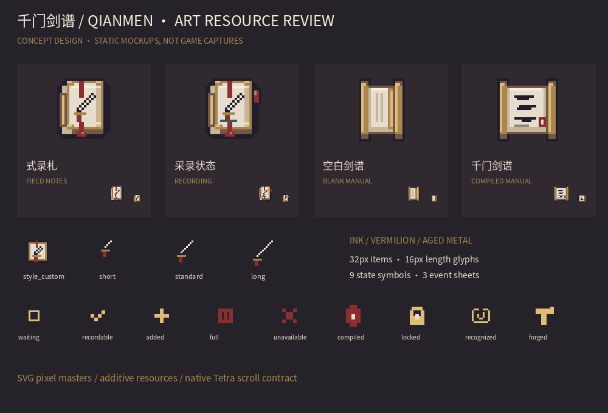

# 千门剑谱 · 自创流派美术包

**全部展示图均为概念设计，不是 Minecraft 实机截图。** 本包没有实现采录、
编纂、工作台识别或加工逻辑。资源位于标准 Minecraft 资源目录，但需核心开发者绑定后才可见。

## 基线与风格依据

- 开发基线：`main`，`8132bc8fd48675717717353e0b03294f715909a3`。
- 参考：`docs/ART_INVENTORY_REVIEW.md` 的克制金属边缘规范；
  `art-previews/legacy_imprint_scroll_redesign.svg` 的旧金、暖纸与深轮廓；
  `LegacyImprintScreen` 的纸色底板、朱红分隔和原生按钮；
  `ForgingScrolls` 的原生 `ScrollItem` / `ScrollData` 表现方式。
- 现有物品通常为 32×32，因此新增物品同规格；图标按实际 GUI 尺寸制作。
- 胁差、打刀、野太刀已有 `model/modular/alpha9/` 模型。只建议复用对应形状，
  没有改动模型、材质或原四流派；具体复用映射由核心决定。
- 新图全部是本任务原创 SVG 像素几何。无 AI 位图缩小、随机噪声、外部贴图复制或新增第三方字体分发。

## 审查入口



| 内容 | 中文 | English |
|---|---|---|
| 轻量 HUD | [预览](mockups/hud_zh.png) | [Preview](mockups/hud_en.png) |
| 剑谱管理 | [预览](mockups/editor_zh.png) | [Preview](mockups/editor_en.png) |
| 工作台信息布局建议 | [预览](mockups/workbench_zh.png) | [Preview](mockups/workbench_en.png) |

工作台图仅示意新增内容的相对分组，不是替换原生 Tetra Screen 的背景。
[动画原始帧总览](mockups/animation-frames.png)。

六张界面图的逻辑画布为 320×240，PNG 用最近邻放大三倍；SVG 保留可编辑文字。
GUI Scale 和真实字体验收仍待核心接入后进行，不能从这些图推断已通过实机兼容测试。

## 制作、导出与检查

Python 3.10+，建议在独立环境安装 `requirements.txt`。

```sh
python -m pip install -r docs/custom-style-art/requirements.txt
python docs/custom-style-art/export_assets.py
python docs/custom-style-art/export_assets.py --check
python docs/custom-style-art/validate_assets.py
python docs/custom-style-art/render_mockups.py --font /path/to/your/licensed-cjk-font.otf
```

最后一条只用于说明图；生产资源导出不需要字体。字体路径必须显式提供，不保存开发机路径。
`Pillow` 精确绘制整数矩形和多边形像素中心，不依赖浏览器抗锯齿或本地 SVG 工具版本。
SVG 的受支持词汇限 `rect`、`polygon`、`title`、`desc`；新增图形需转换为这一词汇或显式扩展导出器。
所有路径相对于脚本所在仓库；从其他工作目录调用同样有效。

- [资源清单](asset-manifest.md) / [机器清单](export/asset-manifest.json)
- [布局、文本和交互](ui-layout-spec.md)
- [核心开发接口契约](integration-contract.md)
- [验证记录及待验收项](validation-report.md)

本 PR 仅交付美术与接口设计，保持 Draft，禁止自动合并。
